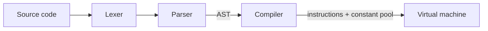

# Monkey Compiler in Go

A bytecode compiler and stack-based virtual machine for the Monkey programming language, written from scratch in Go with no dependencies outside the standard library.

The project follows Thorsten Ball's books [Writing An Interpreter In Go](https://interpreterbook.com/) and [Writing A Compiler In Go](https://compilerbook.com/). The lexer, parser, and tree-walking evaluator come from the first book; the compiler and VM from the second replace the evaluator as the way programs are run. It is an educational implementation, not a production language.

## Example

```monkey
let fibonacci = fn(n) {
  if (n < 2) { return n; }
  fibonacci(n - 1) + fibonacci(n - 2)
};

let newAdder = fn(a) { fn(b) { a + b } };
let addTwo = newAdder(2);

let people = [{"name": "Alice", "age": 24}, {"name": "Bob", "age": 31}];

puts(fibonacci(15));
puts(addTwo(40));
puts(people[1]["name"]);
```

```
610
42
Bob
```

## Features

- Integers, booleans, strings, and `null`.
- Arithmetic (`+`, `-`, `*`, `/`), comparison (`==`, `!=`, `<`, `>`), and prefix (`!`, `-`) operators.
- String concatenation with `+`.
- Global and local `let` bindings.
- `if`/`else` as expressions, compiled to conditional and unconditional jumps.
- Array and hash literals, with index expressions on both.
- First-class functions with arguments, explicit `return`, and implicit return of the last expression.
- Closures that capture free variables from enclosing functions.
- Recursive functions, including ones defined inside other functions.
- Built-in functions callable from any scope.

### Built-in functions

| Function | Behavior |
| --- | --- |
| `len(x)` | Length of a string or array. |
| `puts(...)` | Prints each argument on its own line. |
| `first(array)` | First element, or `null` if the array is empty. |
| `last(array)` | Last element, or `null` if the array is empty. |
| `rest(array)` | New array without the first element. |
| `push(array, x)` | New array with `x` appended; the original is unchanged. |

## How it works

Source code passes through four stages:



1. The lexer turns source text into tokens.
2. The Pratt parser builds an AST from the tokens.
3. The compiler walks the AST and emits a flat byte slice of instructions, plus a constant pool holding literals and compiled functions.
4. The VM executes the instructions on a value stack, using one call frame per function invocation.

Each instruction is a one-byte opcode followed by zero or more big-endian operands. `OpConstant`, for example, carries a two-byte index into the constant pool rather than the value itself, so every instruction has a fixed, known width.

The symbol table resolves each identifier at compile time to a global, local, builtin, free, or function scope, and the compiler emits the matching load instruction. Functions are compiled into their own instruction sequences and wrapped in closures at runtime together with the free variables they captured.

### Instruction set

| Area | Opcodes |
| --- | --- |
| Constants and literals | `OpConstant`, `OpTrue`, `OpFalse`, `OpNull` |
| Arithmetic | `OpAdd`, `OpSub`, `OpMul`, `OpDiv`, `OpMinus` |
| Comparison and logic | `OpEqual`, `OpNotEqual`, `OpGreaterThan`, `OpBang` |
| Control flow | `OpJump`, `OpJumpNotTruthy` |
| Bindings | `OpSetGlobal`, `OpGetGlobal`, `OpSetLocal`, `OpGetLocal`, `OpGetBuiltin`, `OpGetFree` |
| Data structures | `OpArray`, `OpHash`, `OpIndex` |
| Functions | `OpCall`, `OpReturnValue`, `OpReturn`, `OpClosure`, `OpCurrentClosure` |
| Stack | `OpPop` |

There is no less-than opcode: `a < b` is compiled as `b > a` by emitting the operands in reverse order.

### Limits

| Limit | Value |
| --- | --- |
| Stack size | 2,048 values |
| Global bindings | 65,536 |
| Call frames | 1,024 |
| Constants per program | 65,536 |

## Project structure

| Path | Responsibility |
| --- | --- |
| `token` | Token types and keyword lookup. |
| `lexer` | Converts source text into tokens. |
| `ast` | AST node definitions. |
| `parser` | Pratt parser producing the AST. |
| `object` | Runtime values, compiled functions, closures, and built-in functions. |
| `code` | Opcode definitions, instruction encoding, and disassembly. |
| `compiler` | AST-to-bytecode compiler and symbol table. |
| `vm` | Stack-based virtual machine and call frames. |
| `repl` | Interactive prompt backed by the compiler and VM. |
| `evaluator` | Tree-walking interpreter from the first book, kept for reference. |

## Running

The project requires Go 1.26.1 or newer.

Start the REPL:

```sh
go run .
```

```
>> 1 + 2 * 3
7
>> let numbers = [1, 2, 3];
[1, 2, 3]
>> rest(numbers)
[2, 3]
```

Definitions persist between lines, because the REPL keeps the symbol table, constant pool, and globals across inputs.

Run a source file:

```sh
go run . main.monkey
```

Parser, compiler, and VM errors are written to stderr and the process exits with status `1`.

To build the executable:

```sh
go build -o monkey .
./monkey main.monkey
```

## Testing

Run the complete test suite with:

```sh
go test ./...
```

The tests cover the lexer, parser, evaluator, instruction encoding, symbol resolution, compiler output for each language construct, and end-to-end VM execution.
